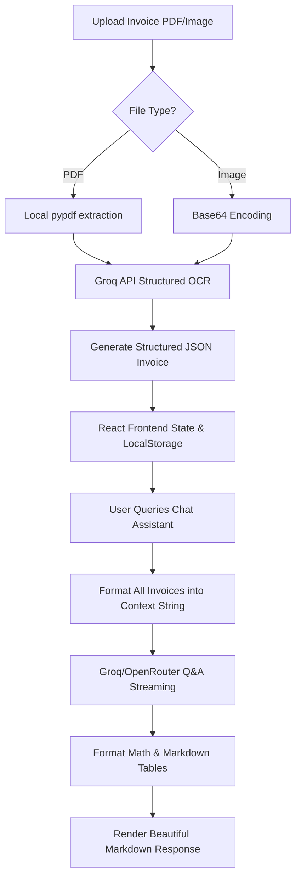

# 🧾 BillWise RAG: Invoice & Bill Information Extractor

BillWise RAG is a serverless, full-context Retrieval-Augmented Generation (RAG) application that parses key details from uploaded bill PDFs and image screenshots and allows you to analyze them using conversational AI. 

Built with a **React (Vite)** frontend and a **FastAPI (Python)** serverless backend, it is optimized for hosting on **Vercel** and uses **Groq's** Llama 3 models for visual extraction and structured RAG querying.

---

## 🚀 How the RAG Pipeline Works

Traditional RAG pipelines chunk text and index it in a vector database. While this works for large books, it fails for bills and invoices because:
- Split tables lose their columns and layout structure, making data retrieval inaccurate.
- Vector searches struggle with mathematical queries (e.g., *"What is my average spend?"* or *"Compare Comcast and PG&E"*), since they only retrieve a subset of text chunks instead of aggregating all files.

**BillWise RAG solves this with a Hybrid Structured RAG Pipeline:**



### Step-by-Step Data Flow:
1. **Document Ingestion**: You upload a bill (either a digitally created PDF or a PNG/JPG screenshot).
2. **Local Text Extraction**: If it's a PDF, `pypdf` extracts the text locally for speed. If it's an image, the frontend encodes it to base64.
3. **Structured OCR Layer**: The text or image is sent to Groq's API with a system prompt that mandates a strict JSON response schema.
4. **Stateless Frontend Storage**: The extracted structured JSON (vendor, invoice number, totals, tax, line items, dates) is returned to the React frontend, which stores it in memory and persists it in `localStorage` (so your uploaded bills stay active even if you refresh your browser).
5. **RAG Retrieval & Context Building**: When you ask a question (e.g., *"What did I spend at KSEB?"*), the React app formats the structured JSON of all your bills into a clean, text-based document catalog (the Context) and sends it with your query to the chat assistant.
6. **Streaming Q&A Generation**: The API streams the response back chunk-by-chunk using a serverless streaming generator.
7. **Markdown & LaTeX Rendering**: The UI intercepts the streamed text, parses markdown tables and LaTeX equations on the fly, and displays a styled, beautiful response.

---

## ✨ Features

- **Multimodal Document Parsing**: Upload digitally created PDFs or image files. The backend extracts text locally or feeds base64 image data to Groq's vision models.
- **Structured JSON Extraction**: Converts unstructured invoice data into structured JSON matching a rigorous invoice schema (Vendor, Invoice Number, Issue/Due Dates, Total/Tax Amounts, Currency, and Itemized Line Items).
- **Interactive SaaS Dashboard**: View overall spending stats (Total Spend, Avg Bill, Count, Vendor Distribution) and inspect individual invoices in detail.
- **Conversational RAG Assistant**: Ask questions about your bills. Supports step-by-step mathematical reasoning and compiles tables in chat responses.
- **On-the-Fly LaTeX & Markdown Table Parsing**: 
  - Automatically parses LaTeX equations (`\[ ... \]`, `$$ ... $$`, `\( ... \)`) and renders them in centered, styled math blocks.
  - Dynamically renders Markdown tables (`| ... |`) as beautiful HTML tables.
- **In-Memory & LocalStorage Persistence**: Keeps uploaded data active on page reloads without requiring an external database.
- **Theme Toggle**: Beautiful, fluid dark and light theme options matching the Zinc Design System.
- **Custom API Base URL**: Flexible configuration support for any OpenAI-compatible API provider (e.g., Groq, OpenRouter, OpenAI, local Ollama/LM Studio).

---

## 🛠️ Project Architecture

```
bill_info_extractor_using_RAG/
├── vercel.json          # Vercel API routing configuration
├── package.json         # Node.js dependencies (React, Lucide icons)
├── requirements.txt     # Python backend dependencies (FastAPI, pypdf, openai)
├── vite.config.js       # Vite configuration with local proxy
├── api/
│   └── index.py         # FastAPI main serverless handler
├── utils/
│   ├── extractor.py     # Document text/image parser & JSON extractor
│   └── rag.py           # Context generator & Q&A prompt engine
├── src/
│   ├── App.jsx          # React app layout (Dashboard & Chat tabs)
│   ├── index.css        # Zinc styling tokens & LaTeX parser overrides
│   └── main.jsx         # JavaScript Entrypoint
```

---

## 🚀 Getting Started (Run Locally)

### Prerequisites
- Python 3.10+
- Node.js (with npm)
- A **Groq API Key** (Get it from [Groq Console](https://console.groq.com/)) or an OpenRouter key.

### Setup Instructions

1. **Clone the Repository**:
   ```bash
   git clone https://github.com/albertcyriac04-lgtm/bill_info_extractor_using_RAG.git
   cd bill_info_extractor_using_RAG
   ```

2. **Setup the Python Backend**:
   Create a virtual environment and install dependencies:
   ```bash
   python -m venv .venv
   # On Windows:
   .venv\Scripts\pip install -r requirements.txt
   # On macOS/Linux:
   .venv/bin/pip install -r requirements.txt
   ```

3. **Configure Environment Variables**:
   Copy `.env.template` to `.env` and fill in your API key:
   ```bash
   cp .env.template .env
   ```
   Edit `.env`:
   ```env
   GROQ_API_KEY=gsk_your_groq_api_key_here
   ```
   *(Note: `.env` is listed in `.gitignore` and will never be pushed to GitHub.)*

4. **Setup the Frontend**:
   Install npm dependencies:
   ```bash
   npm install
   ```

---

### Running the Application

To run the application locally, start **both** servers in separate terminal windows:

#### Terminal 1: Backend Server (FastAPI)
```bash
# On Windows:
.venv\Scripts\uvicorn api.index:app --reload
# On macOS/Linux:
.venv/bin/uvicorn api.index:app --reload
```
The backend API will run on `http://127.0.0.1:8000` (docs available at `/docs`).

#### Terminal 2: Frontend Server (Vite)
```bash
npm run dev
```
Open **`http://localhost:5173/`** in your browser to view the application.

---

## ⚙️ Model Customization & API Settings

You can customize the API connection directly from the **Settings** panel in the sidebar:
- **API Base URL**: Connect to Groq (`https://api.groq.com/openai/v1`), OpenRouter (`https://openrouter.ai/api/v1`), or local tools like Ollama/LM Studio.
- **Text / RAG Model**: Choose Llama models or input a custom model name (e.g. `openai/gpt-oss-120b`).
- **Vision Model**: Choose `llama-3.2-11b-vision-preview` or any other custom vision model.

---

## ☁️ Deploying to Vercel

The repository is pre-configured with `vercel.json` for seamless serverless deployments.

1. **Install Vercel CLI**:
   ```bash
   npm install -g vercel
   ```
2. **Deploy to a New Project**:
   ```bash
   vercel
   ```
   *Follow the CLI prompts: select **No** when asked to link to an existing project to create a fresh one (e.g. `billinfoextractor`).*
3. **Configure Environment Variable**:
   In your Vercel Dashboard, go to **Settings > Environment Variables** and add `GROQ_API_KEY` (or your OpenRouter key) to securely process requests on the server-side.
